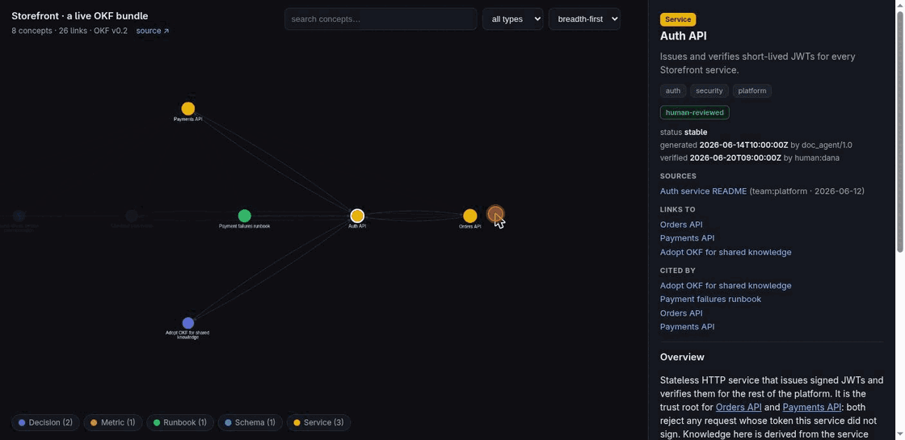

<div align="center">

# okf-skills: an independent, community toolkit for OKF

**Skills and scripts to author, maintain, validate and visualize Open Knowledge
Format bundles: markdown your team and your agents both read.**

[](LICENSE)
[](https://github.com/open-knowledge-format/open-knowledge-format)
[](https://code.claude.com/docs/en/plugins)
[](https://skills.sh/ekar-is/okf-skills)

[](https://ekar-is.github.io/okf-skills/)

**[Open the live demo](https://ekar-is.github.io/okf-skills/)**: an example bundle (a fictional storefront) as an interactive graph. Click a node for the rendered concept, its derived trust tier and staleness, its sources and backlinks. Nothing leaves the page.

</div>

---

[**OKF**](https://github.com/open-knowledge-format/open-knowledge-format) (the [spec](https://github.com/open-knowledge-format/open-knowledge-format/blob/main/SPEC.md)) is, in its own
words, "an open format for *knowledge*: the metadata, context, and curated
insight about data and systems". A bundle is a directory of Markdown files with
YAML frontmatter. OKF has no schema registry, no central authority and no
required tools: if you can `cat` a file you can read it, if you can `git clone`
a repository you can ship it. The frontmatter can carry provenance, trust,
freshness, lifecycle and attestation signals, so a reader can tell a confirmed
fact from a stale guess. The spec was first published by Google Cloud's Data
Cloud team ([announced June 2026](https://cloud.google.com/blog/products/data-analytics/how-the-open-knowledge-format-can-improve-data-sharing))
and is now developed in the [open-knowledge-format](https://github.com/open-knowledge-format/open-knowledge-format) organization.

**okf-skills is an independent, community toolkit for OKF.** It helps an agent
produce, maintain, consume, validate, visualize and backfill bundles, driven by
the vendored spec and a deterministic conformance checker. It ships four ways: a
Claude Code **plugin**, **agent skills** via skills.sh, a **GitHub Action** that
needs no agent, and a read-only **MCP server**.

**Not the official project.** okf-skills is not maintained by or affiliated
with the OKF authors. The OKF project ships its own agent skills,
[`okf-generate` and `okf-consume`](https://github.com/open-knowledge-format/open-knowledge-format/tree/main/skills), and okf-skills
complements them rather than replacing them. You do not need okf-skills to use
OKF: a bundle is plain Markdown, and any editor writes it.

This repo documents itself in OKF: its architecture and decisions live in
[`.okf/`](.okf/), rendered as a [live self-graph](https://ekar-is.github.io/okf-skills/self.html)
and validated on every push.

## Install

| Channel | Command | Notes |
|---|---|---|
| Claude Code plugin | `/plugin marketplace add ekar-is/okf-skills` then `/plugin install okf-skills@ekar-is` | Skills, subagents, Stop hook and MCP server. The full toolchain. |
| Agent skills ([skills.sh](https://skills.sh/ekar-is/okf-skills)) | `npx skills add ekar-is/okf-skills` | Tested in Claude Code. Other hosts that support the Agent Skills format may load them, but that is untested. Installs the okf, validate, visualize and backfill skills. Backfill needs the plugin's subagents, see below. |
| GitHub Action | `uses: ekar-is/okf-skills@v1` | Validates a bundle in CI, no agent needed. |
| MCP server | `uv run servers/okf_mcp.py .okf` | Any MCP host. Bundled with the plugin, nothing to configure there. |
| Local development | `claude --plugin-dir /path/to/okf-skills` | No marketplace. |

The scripts need [`uv`](https://docs.astral.sh/uv/) (or `python3` with `pyyaml`).
One repo serves both layouts: `.claude-plugin/` makes it a marketplace,
`skills/<name>/SKILL.md` makes it skills.sh-discoverable, and scripts resolve
through `${CLAUDE_SKILL_DIR}` so they run from either path. The backfill skill
dispatches the two subagents in `agents/`, which live outside `skills/`, so
backfill works from the plugin install only.

### What each part assumes

| Part | Works on | Needs |
|---|---|---|
| validate, visualize | Any OKF bundle, any domain | Python 3.11+ with `uv` (or `pip install pyyaml`) |
| okf skill (author, maintain, consume) | Any domain | A coding agent, written for Claude Code first |
| backfill | A git repository | Claude Code session history and the plugin's subagents. Claude Code only |
| Stop hook (enforced upkeep) | A git repository | Claude Code, opt-in via `x-okf-skills-upkeep: enforced` in the root `index.md` |
| MCP server | Any OKF bundle (the project's `.okf/` by default, or `$OKF_BUNDLE`) | Any MCP host over stdio. Claude Code wires it automatically |

The `.okf/` location is an okf-skills convention, not part of the spec. The
validator, visualizer, MCP server, Action and okf skill accept any bundle path.
The Stop hook and the backfill skill only use `.okf/`.

## Use it

**Capture knowledge.** Ask Claude to "document the auth service in OKF", or:

```shell
/okf-skills:okf produce .okf
```

**Backfill a repo that predates the bundle.** Event-sources git history and
Claude session transcripts into concepts, with a deterministic extractor and an
auditable map/reduce over subagents:

```shell
/okf-skills:backfill .
```

**Validate** before committing. The checker is deterministic, §11 of the spec,
not an eyeball pass. `--strict` fails on any spec warning, and a concept with
only `type` passes it. `--lint` adds the okf-skills house style (warnings for a
missing `title`, `description`, `tags` or `generated`), which is optional and
not spec. `--migrate` upgrades v0.1 and v0.2 bundles to v0.3 in place:

```shell
/okf-skills:validate .okf --strict
uv run skills/validate/scripts/okf_validate.py .okf --strict      # zero-config
uv run skills/validate/scripts/okf_validate.py .okf --strict --lint  # plus house style
uv run skills/validate/scripts/okf_validate.py .okf --max-warnings 5
```

**Gate it in CI** with the composite action. `@v1` tracks the latest release
while the repo is pre-1.0. Pin `@okf--v<version>` to freeze it. The step exposes
the validator's JSON as the `report` output.

```yaml
- uses: ekar-is/okf-skills@v1
  with:
    bundle: .okf
    strict: "true"      # or: max-warnings: "5"
```

**Visualize** the graph as a self-contained `viz.html`
([live example](https://ekar-is.github.io/okf-skills/)). Every concept gets
a deep link (`viz.html#services/auth-api`), and each panel shows two derived
badges: the §5.3 trust tier and staleness once `stale_after` has passed. OKF
stores neither, so both are computed at render time. Above 1000 concepts the
layout falls back to concentric. `--layout cose` overrides, and `--max-nodes N` refuses.

```shell
/okf-skills:visualize .okf
uv run skills/visualize/scripts/okf_visualize.py .okf -o viz.html \
  --title "My project" --link "https://github.com/me/project"
```

**Read a bundle over MCP.** Three read-only tools: nothing writes and no id
resolves outside the bundle root. Inside Claude Code the server starts with the
plugin on `./.okf` and appears as `mcp__plugin_okf-skills_bundle__*`. For Claude Code
it duplicates Read and Grep, and [the decision record](.okf/decisions/mcp-server.md)
says so. It ships for the hosts that have nothing else.

| Tool | Returns |
|---|---|
| `search_concepts(query, limit)` | Concept cards (`id`, `type`, `title`, `description`, `status`, `current`, `superseded_by`, `tier`, `stale_after`, `stale`). Metadata hits rank above body hits. |
| `read_concept(concept_id)` | One concept verbatim, frontmatter included. The id is the bundle path without `.md`. |
| `get_neighbors(concept_id)` | `outgoing` and `incoming` cards from markdown links and bundle-internal `sources`. |

Any other host: run `uv run servers/okf_mcp.py <bundle>` as a stdio server
(a bundle path, else `$OKF_BUNDLE`, else `./.okf`).

**Keep it up to date.** Two opt-in modes. *Soft:* paste
[`templates/CLAUDE-okf.md`](templates/CLAUDE-okf.md) into your `CLAUDE.md` so
Claude consults `.okf/` before a task and writes back after. *Enforced:* add
`x-okf-skills-upkeep: enforced` to `.okf/index.md`'s frontmatter to arm the plugin's dormant
`Stop` hook, which blocks finishing when tracked files changed but nothing under
`.okf/` did. If the bundle documents git repos checked out inside the project,
add `x-okf-skills-recursive: true` (or a depth, `x-okf-skills-recursive: 3`) so the hook finds them and
counts their uncommitted changes too. Depth is how many directory levels below
the project root a repo's directory may sit (`repos/app` is 2), and `true` means 6. The older unprefixed `upkeep` / `recursive` keys still work as
deprecated aliases. `OKF_HOOK=off` overrides any bundle. Details:
[stop-hook concept](.okf/components/stop-hook.md).

## What's inside

| Component | What it does |
|---|---|
| `skills/okf/` | Produce / maintain / consume bundles from the spec and templates. Auto-triggers in repos that have one. `scripts/okf_init.py` scaffolds a starter bundle. |
| `skills/validate/` | `scripts/okf_validate.py`: standalone §11 conformance checker, `--strict`, `--max-warnings`, `--lint`, `--json`, `--migrate`. |
| `skills/visualize/` | `scripts/okf_visualize.py`: bundle to `viz.html`. |
| `skills/backfill/` | Reconstruct a bundle from history. `scripts/okf_backfill_events.py` extracts events and emits capped diffs deterministically. |
| `agents/` | `event-analyzer` (map, cheap tier) and `bundle-weaver` (reduce, the only writer) for the backfill. |
| `servers/okf_mcp.py` | The read-only MCP server, wired by `.mcp.json`. |
| `hooks/` | The dormant Stop hook, armed by `x-okf-skills-upkeep: enforced`. |
| `action.yml` | Composite GitHub Action around the validator. |
| `templates/CLAUDE-okf.md` | The soft-mode snippet. |
| `skills/okf/reference/SPEC.md` | OKF v0.3, vendored verbatim: the source of truth. |
| `examples/sample-bundle/` | The bundle behind the live demo: a fictional store backend. |
| `examples/data-catalog/` | A small retail analytics catalog: tables, a metric with an attested computation, a policy, a glossary term, a runbook. |
| `benchmark/` | Three published experiments, protocols and runs. |

## How a bundle looks

A concept's path is its id. A concept is a `.md` file whose YAML frontmatter
has a non-empty `type`. Everything else is optional, and a `README.md` without
frontmatter is simply not a concept.

```
.okf/
├── index.md                  # progressive disclosure (root: okf_version, title, description)
├── log.md                    # ISO-dated lifecycle events, newest first
├── services/auth-api.md      # one concept = one file
└── decisions/use-okf.md
```

```markdown
---
type: Service
title: Auth API
description: Issues and verifies short-lived access tokens.
status: stable
stale_after: "2026-12-31T00:00:00Z"
generated: { by: doc_agent/1.0, at: "2026-06-14T10:00:00Z" }
verified: { by: "human:dana", at: "2026-06-20T09:00:00Z" }
sources:
  - id: auth-readme
    resource: https://github.com/acme/auth#readme
    last_modified: "2026-06-12T00:00:00Z"
---

# Endpoints
Tokens live 15 minutes.[^auth-readme]

[^auth-readme]: Auth service README
```

**The metadata families**, all optional, all in frontmatter. Normative detail in
[`SPEC.md`](skills/okf/reference/SPEC.md).

| Family | Fields | Answers |
|---|---|---|
| Provenance | `sources[]` with `author`, `usage_count`, `last_modified`, `usage_window` | Where did this come from, how credible is it? |
| Trust | `generated: {by, at}`, `verified[]`, actor prefixes `human:` / `team:` / `process:` / `agent/version` | Who wrote it, who confirmed it since the last change? |
| Lifecycle | `status`, `superseded_by`, `stale_after` | Is it current, what replaced it, when to check again? |
| Attestation | `type: Attested Computation` with `runtime`, `parameters`, `executor`, `attester` | Was this number produced the sanctioned way? |

**What v0.3 changed** (§13): a bare path field resolves from its file's
directory, not the bundle root, and a trust tier counts only verifications at or
after `generated.at`. Date-only timestamps are valid again, a date-time needs an
offset, the root `index.md` gains `title` / `description` / `license`, and
`x-` keys are reserved for extensions.

Upgrading from v0.1 or v0.2: the tools read the old forms (with the §12.1
root fallback for v0.2 path fields), flag them as warnings, and
`okf_validate.py --migrate` rewrites them in place.

## What has been measured

Three experiments in [`benchmark/`](benchmark/), each published with its
protocol, runs and the defects it exposed. None of them estimates what OKF is
worth in a real repository, where prose and history already carry recency.

- **Trust metadata** ([results](benchmark/trust/RESULTS.md), pre-registered): with
  v0.2 lifecycle fields present the consumer never asserted a superseded fact, and
  read the fields unprompted. The main comparison is invalid under the protocol's
  own rule: on 7 of 43 items one group never committed to an answer, mostly the
  control, which said 'unknown'.
- **Write-side gate** ([results](benchmark/gate/RESULTS.md), pre-registered): a
  process gate and an expired `stale_after` each reduced stale answers, and the
  two are not distinguishable on 20 items. Ungated writers left docs untouched
  57% of the time, which is where the metadata acts. In this second setup a
  concept marked `deprecated` still produced a stale answer in 27% of trials,
  against 0% in the first experiment.
- **Backfill map tier** ([results](benchmark/map-tier/RESULTS.md), engineering
  A/B, one run per arm): batching small events eight per call cut the map phase by
  a third, and the cheap tier matched `sonnet` on commits once two instructions were
  made explicit.

A third party measures a different claim, sufficiency:
[`aws-samples/sample-okf-llm-wiki`](https://github.com/aws-samples/sample-okf-llm-wiki)
scores EX 74.0 on BIRD mini_dev (500 text-to-SQL questions) from the bundle alone.

## Contributing

Issues and PRs are welcome, and you only need to bring the change, its tests and
a clear description. The maintainers handle the release chores before merging:
the version bump in `.claude-plugin/plugin.json`, the `CHANGELOG.md` entry and
the matching update to this repo's own `.okf/` bundle (merging to `main` then
tags and releases automatically). CI validates the manifests, the bundles, the
action, the docs regeneration and the test suites on every push. This repo's
bundle sets `x-okf-skills-upkeep: enforced`, so if you work here with the plugin
installed the Stop hook asks for the matching concept update, and
`OKF_HOOK=off` opts out. How decisions are made, and the local commands that
mirror CI, are in [CONTRIBUTING.md](CONTRIBUTING.md). Questions about the format
itself belong upstream, in the
[OKF repository](https://github.com/open-knowledge-format/open-knowledge-format).
Report vulnerabilities privately, as [SECURITY.md](SECURITY.md) describes.

## Credits & license

- The **Open Knowledge Format** specification originates from the Google Cloud
  Data Cloud team, Apache-2.0, now at [open-knowledge-format/open-knowledge-format](https://github.com/open-knowledge-format/open-knowledge-format)
  (the earlier copies under `GoogleCloudPlatform/open-knowledge-format` and
  `knowledge-catalog/okf` are no longer updated).
  `skills/okf/reference/SPEC.md` is vendored verbatim with attribution.
- This plugin's own code and content: **MIT** © ekar.is and the okf-skills contributors ([@ekar-is](https://github.com/ekar-is)).
